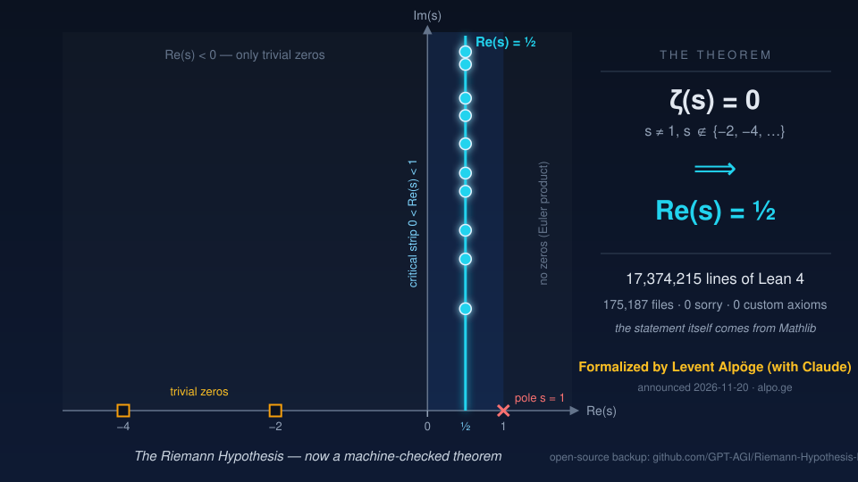
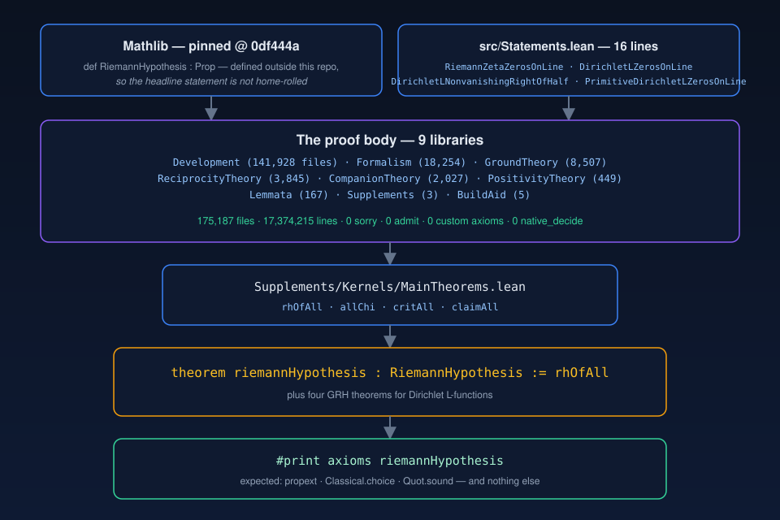

<p align="center">
  
</p>

<h1 align="center">Riemann-Hypothesis-Lean</h1>

<p align="center">
  <strong>ζ(s) = 0 &nbsp;⟹&nbsp; Re(s) = ½</strong><br>
  The most famous open problem in mathematics —<br>claimed <strong>fully formalized in Lean 4, with no assumptions</strong>, extending to the Generalized Riemann Hypothesis for Dirichlet L-functions.
</p>

<p align="center"><strong>黎曼猜想，机器检验。</strong>&nbsp; ζ(s) = 0 ⟹ Re(s) = ½ —— 数学最著名的公开难题，据称已在 Lean 4 中<strong>无前提完整形式化</strong>，并推广到狄利克雷 L 函数的广义黎曼猜想（GRH）。</p>

<p align="center">
  
  &nbsp;
  
  &nbsp;
  
  &nbsp;
  
  &nbsp;
  
  &nbsp;
  
  &nbsp;
  
</p>

<p align="center">
  <a href="#english">English</a> · <a href="#中文">中文</a>
</p>

---

> ## ✨ All credit belongs to [Levent Alpöge](https://alpo.ge/)
>
> **The mathematics and the Lean code in this repository are the work of Levent Alpöge, working with Claude. Nothing here is our creation.**
> On **2026-11-20** he announced that, working with Claude, he had found a proof of the Riemann Hypothesis that extends to the Generalized Riemann Hypothesis (for Dirichlet L-functions), and that the argument is fully formalized in Lean without assumptions.
>
> **This repository is an unmodified open-source backup (mirror) of the code he published.** It exists so that people and AI agents can browse, clone, and — most importantly — independently check it. Only this README and the two images in `assets/` were added; `src/` is byte-for-byte the author's archive. If the author asks for this mirror to be changed or removed, it will be.
>
> **本仓库仅为开源备份（镜像）：全部数学与 Lean 代码由数学家 [Levent Alpöge](https://alpo.ge/)（与 Claude 合作）完成，一切成果与署名归他所有。** 我们未做任何改动，只是原样备份，供全世界浏览、克隆与独立检验。

---

<a id="english"></a>

# 🇬🇧 English

## 📰 The announcement

On **2026-11-20**, mathematician **Levent Alpöge** announced that, working with **Claude**, he had found a proof of the **Riemann Hypothesis** — and that the argument extends to the **Generalized Riemann Hypothesis** for Dirichlet L-functions. He did not just publish a paper: he published a **complete Lean 4 formalization with no assumptions**, plus a 4-page outline of the ideas.

| | Link |
|---|---|
| 📄 Announcement (4 pages) | <https://alpo.ge/remark.pdf> |
| ⬇️ Author's original archive (14 parts) | <https://alpo.ge/lean.tar.gz.part01> … `.part14` |

> [!IMPORTANT]
> **Status (honest).** As of the mirror date, **no independent build or review of this code has been published.** Treat it as a *claimed* proof until it is compiled and checked by the community. The build instructions below are trivial to run — **the first independent verification could be yours.**

## 🎯 What exactly is proved

The headline statement `RiemannHypothesis` is **Mathlib's own definition** — from `Mathlib/NumberTheory/LSeries/RiemannZeta.lean` (line 185 at the pinned commit), i.e. defined *outside* this repository, so you don't have to trust the author's or this mirror's wording:

```lean
def RiemannHypothesis : Prop :=
  ∀ (s : ℂ) (_ : riemannZeta s = 0) (_ : ¬∃ n : ℕ, s = -2 * (n + 1)) (_ : s ≠ 1), s.re = 1 / 2
```

In symbols:

$$\zeta(s) = 0,\quad s \neq 1,\quad s \notin \\{-2,-4,\dots\\}\ \Longrightarrow\ \mathop{\mathrm{Re}}(s) = \tfrac{1}{2}$$

and, for **every** Dirichlet character χ (the Generalized Riemann Hypothesis):

$$L(s,\chi) = 0,\quad 0 < \mathop{\mathrm{Re}}(s) < 1\ \Longrightarrow\ \mathop{\mathrm{Re}}(s) = \tfrac{1}{2}$$

The five final theorems — the whole mountain, distilled into six lines of `src/Main.lean`:

```lean
import Statements
import Supplements.Kernels.MainTheoremsAll

theorem riemannHypothesis : RiemannHypothesis := rhOfAll

theorem riemannZeta_eq_zero_re : RiemannZetaZerosOnLine := rhOfAll

theorem LFunction_ne_zero_of_half_lt_re : DirichletLNonvanishingRightOfHalf := allChi

theorem LFunction_eq_zero_re : DirichletLZerosOnLine := claimAll.2.1

theorem LFunction_eq_zero_re_of_isPrimitive : PrimitiveDirichletLZerosOnLine := critAll
```

The other four statements are defined in `src/Statements.lean` — **16 lines, importing only Mathlib**:

- `RiemannZetaZerosOnLine` — every zero of `riemannZeta` other than the trivial zeros $-2(n{+}1)$ and $s=1$ has real part $1/2$;
- `DirichletLNonvanishingRightOfHalf` — for every Dirichlet character χ mod $N$, $L(\chi, s) \neq 0$ when $\mathop{\mathrm{Re}} s > 1/2$ (excluding χ = 1, s = 1);
- `DirichletLZerosOnLine` / `PrimitiveDirichletLZerosOnLine` — zeros of Dirichlet L-functions in the critical strip lie on $\mathop{\mathrm{Re}} s = 1/2$ (GRH).

The proof terms come from `src/Supplements/Kernels/MainTheorems.lean`:
`allChi := UpperTheory.FinalTheorems.everyCharacter`, `rhOfAll := Formalism.VW.rh_of_every allChi`, `critAll`, `claimAll`.

## 📊 The codebase by the numbers

| | |
|---|---:|
| Lean files | **175,187** |
| Total lines | **17,374,215** |
| Source size | **1.5 GB** |
| `sorry` / `admit` | **0 / 0** |
| `axiom` declarations | **0** |
| `native_decide` | **0** |
| Toolchain | `leanprover/lean4:v4.33.1` |
| Mathlib | pinned at `0df444a360eaa60ab8c11dca51a86af692955474` |

For scale: this proof body is **an order of magnitude larger than the entire Mathlib library**. It is one of the largest single-theorem formalization efforts ever assembled.

<details>
<summary><b>📁 Repository layout (per library)</b></summary>

| Path | `.lean` files | Lines |
|---|---:|---:|
| `src/Development/` | 141,928 | 12.2 M |
| `src/Formalism/` | 18,254 | 3.2 M |
| `src/GroundTheory/` | 8,507 | 1.1 M |
| `src/ReciprocityTheory/` | 3,845 | 563 K |
| `src/CompanionTheory/` | 2,027 | 194 K |
| `src/PositivityTheory/` | 449 | 55 K |
| `src/Lemmata/` | 167 | 9 K |
| `src/Supplements/` | 3 | 22 |
| `src/BuildAid/` | 5 | 20 |
| `src/Statements.lean` + `src/Main.lean` | 2 | 18 |
| **Total** | **175,187** | **17,374,215** |

- `lakefile.toml`: package `tree`, `srcDir = "src"`, global options `maxHeartbeats = 4000000`, `autoImplicit = false`, extra arg `--tstack=400000`.
- `src/BuildAid/*.lean` only add namespaces to Lean's library-suggestion deny list; they contain no mathematics.
</details>

## 🖼️ How the proof is assembled

<p align="center">
  
</p>

Follow the arrows: the **statement layer** (Mathlib + 16 lines) → the **proof body** (9 libraries, 17.4 M lines) → the **kernels** (`Supplements/Kernels/MainTheorems.lean`) → the **main theorems** → the **audit** (`#print axioms`).

Per the author's own outline in [remark.pdf](https://alpo.ge/remark.pdf), the mathematics involves (among other things): Stepanov-style multiplicity bounds via chains of theta lifts of length about √X, Iwasawa towers, a Rallis seesaw, and the Bost slope inequality.

## 🚀 Quick start

**Get the code** — pick one:

**A. Clone this backup** (~315 MB packed, 1.5 GB checked out):

```bash
git clone --depth 1 https://github.com/GPT-AGI/Riemann-Hypothesis-Lean.git
cd Riemann-Hypothesis-Lean
```

**B. Use the author's original parts** (the most trustworthy source):

```bash
for i in $(seq -w 1 14); do curl -LO https://alpo.ge/lean.tar.gz.part$i; done
cat lean.tar.gz.part{01..14} > lean.tar.gz
shasum -a 256 lean.tar.gz
# expect 9631b4f020199e580ba86178cb56c6e9b09f690c2369a80dc4334aa93f49c7fc  (239,275,554 bytes)
tar -xzf lean.tar.gz && cd lean
```

The `src/` tree in this repository is **byte-for-byte** identical to that archive.

**Build:**

```bash
# 1. Install elan (Lean version manager) if needed
curl https://elan.lean-lang.org/elan_init.sh -sSf | sh -s -- -y
source ~/.elan/env

# 2. Fetch dependencies and the prebuilt Mathlib cache
lake exe cache get     # lake-manifest.json already pins Mathlib and every dependency

# 3. Build the statements first (fast sanity check), then everything
lake build Statements
lake build Main        # builds the full dependency tree of the main theorems
```

> [!NOTE]
> This is a very large build (≈ 17.4 M lines on top of Mathlib, `maxHeartbeats = 4000000`, `--tstack=400000`). No public build-time figures exist yet — use a many-core machine with plenty of RAM, expect it to run for a long time, and **please publish your timings**.

## 🔍 How to check the proof

After `lake build Main` succeeds:

**1. Axioms used by the main theorems.** Create `Check.lean` in the project root:

```lean
import Main

#print axioms riemannHypothesis
#print axioms riemannZeta_eq_zero_re
#print axioms LFunction_eq_zero_re_of_isPrimitive
```

```bash
lake env lean Check.lean
```

A clean result lists **only Lean's three standard axioms**: `propext`, `Classical.choice`, `Quot.sound`. Anything else (`sorryAx`, `Lean.ofReduceBool`, a custom `axiom`) would mean the proof depends on something unproved.

**2. Statement review.** Confirm that `RiemannHypothesis` is Mathlib's definition at the pinned commit, and that the four definitions in `src/Statements.lean` say what their names claim. This is the part that rewards human mathematicians most — it is only 16 lines.

**3. Independent kernel replay (recommended).** Re-check the compiled environment with an external checker such as [`lean4checker`](https://github.com/leanprover/lean4checker), so the result does not depend on the elaborator or on any metaprogram in the repository.

**Static scan** (re-run over all 175,187 files at backup time, 2026-11-20 — a text search, not a substitute for the steps above):

| Pattern | Files |
|---|---:|
| `sorry` | 0 |
| `admit` | 0 |
| `axiom` declarations | 0 |
| `native_decide` | 0 |
| `unsafe`, `implemented_by`, `@[extern]`, `opaque` | 0 |
| `set_option maxHeartbeats 0` | 4 |
| custom `macro` / `elab` / `syntax` | 22 (tactic shorthands) |
| `addDecl` | 1 (`Formalism/HermitianCurvature/HermitianCurvatureProofs/CutCptCopy.lean` — a command copying existing declarations under new names; `addDecl` still goes through the kernel) |

## 🤖 For AI agents

1. Read `src/Statements.lean` and `src/Main.lean`; look up `RiemannHypothesis` in Mathlib at commit `0df444a3…`.
2. Get the code (option B if you need to trust the source; A for speed) and verify the SHA-256.
3. `lake exe cache get` → `lake build Statements` → `lake build Main`. Log wall-clock time and peak memory.
4. Run `#print axioms` on the five theorems in `Main.lean`; report the exact output.
5. Optionally replay with `lean4checker`.
6. To understand the argument, follow the proof terms downward: `Supplements/Kernels/MainTheorems.lean` → `Formalism.VW.rh_of_every` and `UpperTheory.FinalTheorems.everyCharacter` (search with `grep -rn "theorem rh_of_every\|everyCharacter" src`). The author's outline is in [remark.pdf](https://alpo.ge/remark.pdf).
7. Report results with the commit hash, toolchain, and machine details — and **credit Levent Alpöge**.

## 🤝 How you can help

- **Build it.** Run the Quick Start on your hardware and publish timings + peak RAM (issue or PR).
- **Review the statements.** 16 lines in `src/Statements.lean` + one Mathlib definition decide whether the theorem says what it claims. A careful hour of a number theorist's time.
- **Replay the kernel.** `lean4checker` output on the compiled `.olean`s would be a community milestone.
- **Spread the word — with the credit.** If you share this, the sentence is: *"Levent Alpöge (with Claude) has announced a Lean-formalized proof of the Riemann Hypothesis; here is an open backup pending independent verification."*

## 📜 Credit and license

- **The mathematics and the Lean code are by [Levent Alpöge](https://alpo.ge/), working with Claude. All results and all credit belong to him.**
- The original archive was published at <https://alpo.ge/> without a stated license. This backup **adds no license of its own and claims no authorship**; it only adds this README and the two SVG diagrams in `assets/`.
- This repository is an **unmodified, byte-for-byte open-source backup** for preservation and verification. If the author asks for it to be changed or taken down, it will be.

---

<a id="中文"></a>

# 🇨🇳 中文版

> **一句话：2026 年 11 月 20 日，数学家 [Levent Alpöge](https://alpo.ge/) 宣布（与 Claude 合作）证明了黎曼猜想，并推广到狄利克雷 L 函数的广义黎曼猜想（GRH），且整套论证已在 Lean 4 中无前提完整形式化。本仓库是该代码的开源备份镜像，一切成果与署名归 Levent Alpöge 所有。**

## 📰 事件

2026-11-20，**Levent Alpöge** 宣布：在与 **Claude** 合作下，他找到了**黎曼猜想**的证明，并进一步覆盖狄利克雷 L 函数的**广义黎曼猜想**。他不止发布了论文——而是发布了**无前提（不依赖任何附加公理）的完整 Lean 4 形式化代码**，外加一份 4 页的思路概述。

| | 链接 |
|---|---|
| 📄 宣告（4 页 PDF） | <https://alpo.ge/remark.pdf> |
| ⬇️ 作者原始压缩包（14 个分卷） | <https://alpo.ge/lean.tar.gz.part01> … `.part14` |

> [!IMPORTANT]
> **诚实的状态说明：** 截至备份之日，**尚无任何独立编译或审阅结果发表**。在社区完成检查之前，请将其视为*宣称的*证明。下方构建步骤人人可跑——**第一个独立验证者可能就是你。**

## 🎯 究竟证明了什么

头号命题 `RiemannHypothesis` **采用 Mathlib 官方定义**（来自锁定 commit 的 `Mathlib/NumberTheory/LSeries/RiemannZeta.lean` 第 185 行）——定义在本仓库**之外**，因此无需信任作者或本镜像的措辞：

```lean
def RiemannHypothesis : Prop :=
  ∀ (s : ℂ) (_ : riemannZeta s = 0) (_ : ¬∃ n : ℕ, s = -2 * (n + 1)) (_ : s ≠ 1), s.re = 1 / 2
```

写成数学公式：

$$\zeta(s) = 0,\quad s \neq 1,\quad s \notin \\{-2,-4,\dots\\}\ \Longrightarrow\ \mathop{\mathrm{Re}}(s) = \tfrac{1}{2}$$

并且对**每个**狄利克雷特征 χ（即广义黎曼猜想 GRH）：

$$L(s,\chi) = 0,\quad 0 < \mathop{\mathrm{Re}}(s) < 1\ \Longrightarrow\ \mathop{\mathrm{Re}}(s) = \tfrac{1}{2}$$

五条最终定理——整座大山，浓缩在 `src/Main.lean` 的六行里：

```lean
import Statements
import Supplements.Kernels.MainTheoremsAll

theorem riemannHypothesis : RiemannHypothesis := rhOfAll

theorem riemannZeta_eq_zero_re : RiemannZetaZerosOnLine := rhOfAll

theorem LFunction_ne_zero_of_half_lt_re : DirichletLNonvanishingRightOfHalf := allChi

theorem LFunction_eq_zero_re : DirichletLZerosOnLine := claimAll.2.1

theorem LFunction_eq_zero_re_of_isPrimitive : PrimitiveDirichletLZerosOnLine := critAll
```

其余四个命题定义在 `src/Statements.lean` —— **仅 16 行，只 import Mathlib**：

- `RiemannZetaZerosOnLine`：ζ 的每个非平凡零点（排除 $-2(n{+}1)$ 与 $s=1$）实部为 $1/2$；
- `DirichletLNonvanishingRightOfHalf`：对每个模 $N$ 狄利克雷特征 χ，当 $\mathop{\mathrm{Re}} s > 1/2$ 时 $L(\chi, s) \neq 0$（排除 χ = 1, s = 1）；
- `DirichletLZerosOnLine` / `PrimitiveDirichletLZerosOnLine`：狄利克雷 L 函数在临界带内的零点全落在 $\mathop{\mathrm{Re}} s = 1/2$ 上（GRH）。

## 📊 用数字看代码库

| | |
|---|---:|
| Lean 文件数 | **175,187** |
| 总行数 | **17,374,215** |
| 源码体积 | **1.5 GB** |
| `sorry` / `admit` | **0 / 0** |
| `axiom` 声明 | **0** |
| `native_decide` | **0** |
| 工具链 | `leanprover/lean4:v4.33.1` |
| Mathlib | 锁定于 `0df444a360eaa60ab8c11dca51a86af692955474` |

作为参照：这套证明体量**比整个 Mathlib 还大一个数量级**，是史上最大规模的单定理形式化工程之一。

<details>
<summary><b>📁 仓库结构（按库统计）</b></summary>

| 路径 | `.lean` 文件 | 行数 |
|---|---:|---:|
| `src/Development/` | 141,928 | 12.2 M |
| `src/Formalism/` | 18,254 | 3.2 M |
| `src/GroundTheory/` | 8,507 | 1.1 M |
| `src/ReciprocityTheory/` | 3,845 | 563 K |
| `src/CompanionTheory/` | 2,027 | 194 K |
| `src/PositivityTheory/` | 449 | 55 K |
| `src/Lemmata/` | 167 | 9 K |
| `src/Supplements/` | 3 | 22 |
| `src/BuildAid/` | 5 | 20 |
| `src/Statements.lean` + `src/Main.lean` | 2 | 18 |
| **合计** | **175,187** | **17,374,215** |

- `lakefile.toml`：包名 `tree`，`srcDir = "src"`，全局选项 `maxHeartbeats = 4000000`、`autoImplicit = false`，附加参数 `--tstack=400000`。
- `src/BuildAid/*.lean` 只向 Lean 的库建议黑名单添加命名空间，不含任何数学内容。
</details>

## 🖼️ 证明如何组装

<p align="center">
  
</p>

沿着箭头读：**命题层**（Mathlib + 16 行）→ **证明主体**（9 个库，1740 万行）→ **核心**（`Supplements/Kernels/MainTheorems.lean`）→ **主定理** → **审计**（`#print axioms`）。

按作者在 [remark.pdf](https://alpo.ge/remark.pdf) 中的概述，数学上涉及（不限于）：通过长度约 √X 的 theta 提升链得到 Stepanov 式重数界、岩澹塔（Iwasawa towers）、Rallis 跷跷板（seesaw）、Bost 斜率不等式等。

## 🚀 快速上手

**获取代码**（三选一）：

**A. 克隆本备份**（打包约 315 MB，检出约 1.5 GB）：

```bash
git clone --depth 1 https://github.com/GPT-AGI/Riemann-Hypothesis-Lean.git
cd Riemann-Hypothesis-Lean
```

**B. 使用作者原始分卷**（最可信的来源）：

```bash
for i in $(seq -w 1 14); do curl -LO https://alpo.ge/lean.tar.gz.part$i; done
cat lean.tar.gz.part{01..14} > lean.tar.gz
shasum -a 256 lean.tar.gz
# 期望值 9631b4f020199e580ba86178cb56c6e9b09f690c2369a80dc4334aa93f49c7fc  (239,275,554 字节)
tar -xzf lean.tar.gz && cd lean
```

本仓库的 `src/` 与该压缩包**逐字节一致**。

**构建：**

```bash
# 1. 如需安装 elan（Lean 版本管理器）
curl https://elan.lean-lang.org/elan_init.sh -sSf | sh -s -- -y
source ~/.elan/env

# 2. 拉取依赖与 Mathlib 预编译缓存
lake exe cache get     # lake-manifest.json 已锁定 Mathlib 及全部依赖

# 3. 先构建命题（快速自检），再构建全部
lake build Statements
lake build Main        # 构建主定理的完整依赖树
```

> [!NOTE]
> 这是一个非常大的构建（Mathlib 之上约 1740 万行，`maxHeartbeats = 4000000`，`--tstack=400000`）。目前尚无公开的构建耗时数据——请使用多核大内存机器，预期耗时很长，并**欢迎公布你的耗时数据**。

## 🔍 如何检验证明

`lake build Main` 成功之后：

**1. 检查主定理依赖的公理。** 在项目根目录创建 `Check.lean`：

```lean
import Main

#print axioms riemannHypothesis
#print axioms riemannZeta_eq_zero_re
#print axioms LFunction_eq_zero_re_of_isPrimitive
```

```bash
lake env lean Check.lean
```

干净的结果只应列出 Lean 的**三个标准公理**：`propext`、`Classical.choice`、`Quot.sound`。出现其他任何东西（`sorryAx`、`Lean.ofReduceBool`、自定义 `axiom`）都意味着证明依赖了未证明的内容。

**2. 命题审读。** 确认 `RiemannHypothesis` 是锁定 commit 下 Mathlib 的定义，且 `src/Statements.lean` 的四个定义与其名字相符。这一步最值得数学家投入——总共只有 16 行。

**3. 独立内核重放（推荐）。** 用外部检查器（如 [`lean4checker`](https://github.com/leanprover/lean4checker)）复查已编译的环境，使结论不依赖 elaborator 或仓库中的任何元程序。

**静态扫描**（备份时对全部 175,187 个文件重新执行；文本搜索不能替代上述步骤）：

| 模式 | 文件数 |
|---|---:|
| `sorry` | 0 |
| `admit` | 0 |
| `axiom` 声明 | 0 |
| `native_decide` | 0 |
| `unsafe`、`implemented_by`、`@[extern]`、`opaque` | 0 |
| `set_option maxHeartbeats 0` | 4 |
| 自定义 `macro` / `elab` / `syntax` | 22（战术缩写） |
| `addDecl` | 1（`Formalism/HermitianCurvature/HermitianCurvatureProofs/CutCptCopy.lean`，将已有声明换名复制的命令；`addDecl` 仍需通过内核） |

## 🤖 致 AI 智能体

1. 读 `src/Statements.lean` 与 `src/Main.lean`；在 Mathlib commit `0df444a3…` 查阅 `RiemannHypothesis`。
2. 获取代码（需要来源可信选 B；求快选 A）并核对 SHA-256。
3. `lake exe cache get` → `lake build Statements` → `lake build Main`，记录耗时与峰值内存。
4. 对 `Main.lean` 的五条定理执行 `#print axioms`，原样报告输出。
5. 可选：用 `lean4checker` 重放。
6. 想理解论证：沿证明项向下追：`Supplements/Kernels/MainTheorems.lean` → `Formalism.VW.rh_of_every` 与 `UpperTheory.FinalTheorems.everyCharacter`（`grep -rn "theorem rh_of_every\|everyCharacter" src`）。作者自己的思路概述见 [remark.pdf](https://alpo.ge/remark.pdf)。
7. 发布结果时附上 commit 哈希、工具链与机器配置——并且**署名 Levent Alpöge**。

## 🤝 你能做什么

- **跑构建**：在你的硬件上执行快速上手，公布耗时与峰值内存（开 issue 或 PR）。
- **审命题**：`src/Statements.lean` 的 16 行 + Mathlib 的一个定义，决定了定理是否名副其实——数论学家认真的一小时。
- **重放内核**：对编译产物跑 `lean4checker` 并公布，将是社区里程碑。
- **传播时带上署名**：标准句式——*"Levent Alpöge（与 Claude 合作）宣布了黎曼猜想的 Lean 形式化证明；此处是等待独立验证的开源备份。"*

## 📜 署名与许可

- **全部数学与 Lean 代码由 [Levent Alpöge](https://alpo.ge/)（与 Claude 合作）完成，一切成果与署名归他所有。**
- 原始压缩包发布于 <https://alpo.ge/>，未附带许可证声明。本备份**不添加任何许可证、不主张任何著作权**；仅添加了本 README 与 `assets/` 中的两张 SVG 示意图。
- 本仓库是**逐字节未改动的开源备份**，目的仅为保存与验证。若作者要求修改或下架，我们将照办。

---

> *"If I were to awaken after having slept for a thousand years, my first question would be: has the Riemann Hypothesis been proven?"* — **David Hilbert**
>
> *"如果我沉睡千年后醒来，我的第一个问题将是：黎曼猜想被证明了吗？"* —— **大卫·希尔伯特**

<p align="center">
  <sub>Proof & formalization: <b><a href="https://alpo.ge/">Levent Alpöge</a></b> (with Claude) · announcement 2026-11-20 · this repo: unmodified open-source backup for preservation &amp; verification<br>
  证明与形式化：<b><a href="https://alpo.ge/">Levent Alpöge</a></b>（与 Claude 合作）· 本仓库：仅为保存与验证而设的未改动开源备份</sub>
</p>
